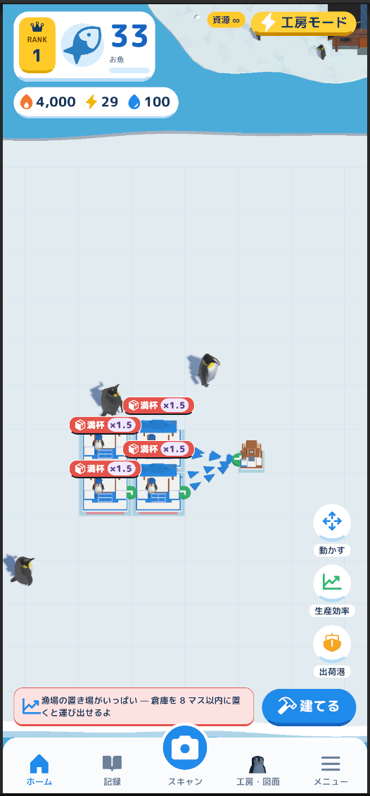
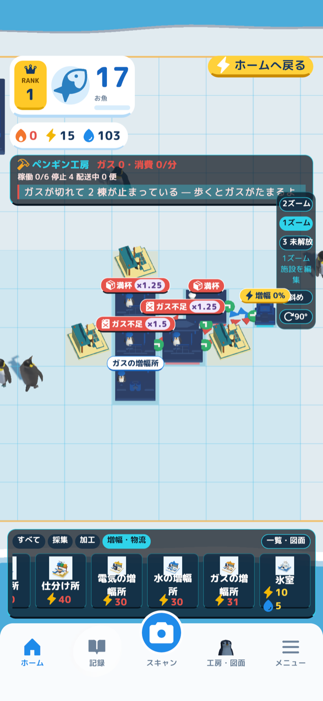
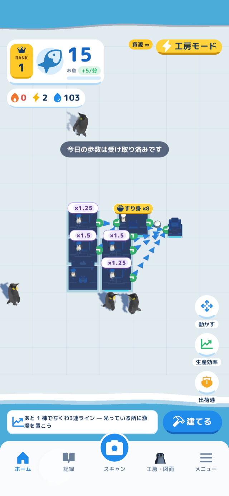
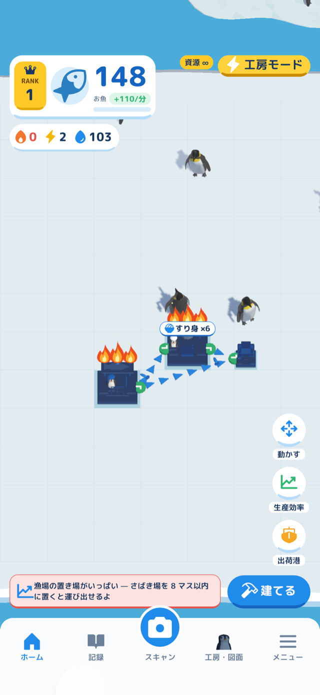
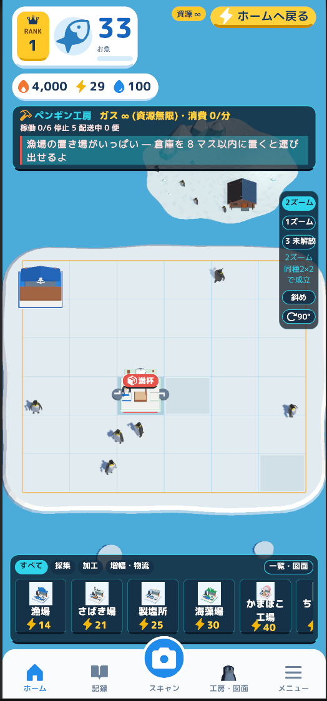
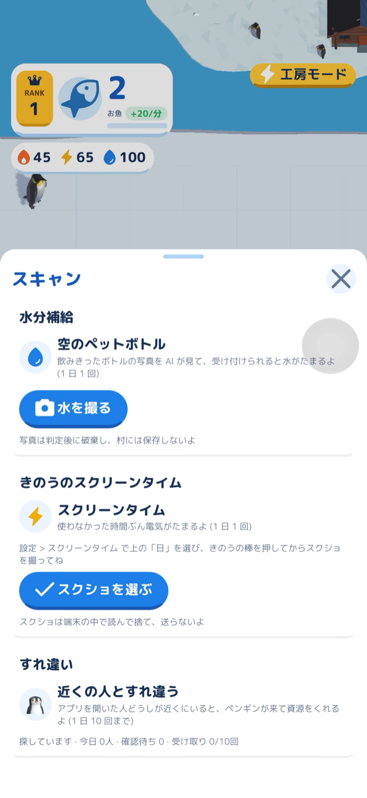

# Project Penguin (プロジェクトペンギン)

**自分の日常の行動が、ゲーム内の工場のエネルギーになる iOS の工場ゲーム。** 歩数はガス、スマホを使わなかった時間は電気、飲みきった空のペットボトルの写真は水になる。生活によって集まる資源の量と比率が変わるので、工場の攻略も人ごとに変わる。

<!-- 画像: 村のホームの全景 (島・施設・下のタブが写るもの) -->

## 製品概要

### 背景(製品開発のきっかけ、課題等）

#### 工場ゲームとは

Factorio や Satisfactory に代表される工場ゲームでは、プレイヤーは未開の土地に降り立ち、鉱石を掘る機械を置くところから始める。掘った鉱石を炉で板にし、組立機で歯車や回路に加工し、ベルトコンベアで機械どうしをつないで、手を動かさなくても生産が続く工場にしていく。研究を進めると新しい機械やレシピが解放され、より高度な製品を作るために工場をさらに広げる。

面白さの中心は、どの機械を何台、どう並べ、どうつなげば、必要な量を無駄なく作れるかを自分で考えることにある。止まっている機械や足りない材料を見つけ、配置を組み直して流れが良くなったときに手応えがある。

#### チームが感じた課題

チームのメンバーには、工場ゲームを途中でやめてしまった経験がある。新しい施設を解放し、それを増やして工場を強くし、また次を解放する。この繰り返しに飽きて、クリアまで続かなかった。

さらに、工場ゲームでは誰が遊んでも同じ方法にたどり着きやすい。必要な機械の比率や強い配置は計算で決まるので、うまい人の工場を参考にすれば、自分で考えなくてもすぐクリアできてしまう。実況動画を見てから遊び始めた人は、答えを知った状態で始めることになり、自分で解き方を見つける面白さを十分に味わえない。マップや手に入るレシピを乱数で変えるゲームもあるが、条件ごとの強い進め方は誰にとっても同じなので、結局は共通の攻略 (メタ) が定まる。

そこで、資源の供給条件を「遊ぶ人の生活」にした。生活習慣はその人に続けて付く条件で、同じ人でも日によって変わる。資源の入り方が人ごとに違えば、他の人の正解をそのまま使えず、自分の条件に合わせて工場を考え直すことになる。

### ペルソナ

工場ゲームを遊んだことがあり、生活習慣の違う 3 人を想定した。製品の仕様から作った架空の人物像で、実際の利用者に当てはまるかは確かめていない。

| | 生活 | 集まりやすい資源 | 考えたくなる攻略 |
|---|---|---|---|
| 1. 外回りの多い会社員 | 仕事で 1 日に 1 万歩以上歩く。連絡や地図でスマホも長く使う | ガスが多く、電気が少ない | 施設を増やしにくいので、少ない施設のエフォートを上げ、ガスを使って速く作る |
| 2. 在宅で作業する人 | 外に出る日が少ない。作業は PC で、スマホはあまり触らない | 電気が多く、ガスが少ない | 施設を多く建てて同種のコンボを並べる。エフォートは 0 のまま、少ないガスで長く動かす |
| 3. 平日は通学、週末は家で過ごす学生 | 平日は駅と大学を歩き、週末は家でスマホのゲームを長く遊ぶ | 平日はガス、それ以外の日は電気と、多い資源が日によって入れ替わる | その日に多い資源を見て、増設とエフォートを切り替える。電車やキャンパスですれ違いも起きやすい |

3 人とも同じ「かまぼこを作る」という目標を持っていても、資源の入り方が違うので、建てる施設の数・並べ方・エフォートのかけ方が変わる。

### 製品説明（具体的な製品の説明）

現実の行動で受け取ったエネルギーを使って、ペンギンの村 (工房モード) に施設を建て、資源の流れを設計する iOS のゲーム。

| 現実の行動 | 受け取るもの | 使い道 |
|---|---|---|
| 歩数 | ガス (1 歩で 2。審査向けの値) | 施設が品物を 1 回作るたびに使う |
| スマホを使わなかった時間 (24 時間 − 前日のスクリーンタイム) | 電気 (使わなかった 2 時間ごとに 1) | 施設の建設 |
| 飲みきった空のペットボトルの写真 | 水 (1 日 1 回、3) | 施設の建設 |
| ほかの利用者とのすれ違い | ペンギンが来て資源をくれる (1 日 10 回まで) | ガス・電気・水として使う |

漁場で魚をとり、さばき場ですり身にし、かまぼこ・ちくわ・干物・おでんへ加工していく。施設は近くの施設や倉庫へ品物を自動で届けるので、線を手で引く必要はない。工房モードでは、施設どうしのつながりと流れる品物が盤面に出て、「ガスが切れた」「送り先が無い」「あと 1 棟で施設群」など、次にやることを 1 つ示す。

<!-- 画像: 工房モードで、施設のつながり (矢印) と流れる品物が見える画面 -->

生産レポートでは、ガスの収支とあと何分でガスが空になるか、品目ごとの生産と消費、止まっている施設とその理由を確かめられる。記録の画面では、今日の歩数と受け取った資源、この 7 日の資源の推移、日ごとの履歴を見られる。初めて遊ぶときは、実際に操作しながら進む 7 段のチュートリアルが始まる。

### 特長

#### 1. 生活によって攻略が変わる

ガスが多い人は、エフォートを上げて今ある施設を速く動かす。電気が多い人は、施設を増やして同種のコンボを伸ばす。同じ種類の施設は建てるほど次の建設費 (電気) が 1 ずつ上がるので、増設だけを続けるとだんだん高くつく。どの資源をどこに使うかは、その人の生活とその日の行動で変わる。

#### 2. 並べ方で動く物流とコンボ

施設は近くの施設や倉庫へ品物を自動で送り、仕分け所の近くでは届く距離が伸びる。同じ種類の施設を上下左右に並べると、1 方向につき生産量が 25% 増え、4 方向そろうと 2 倍になる。コンボは加工の時間もガスも変えないので、ガスが少ない人でも生産量を伸ばせる。決まった形に施設を並べると施設群 (漁場 3 つの「ちくわ3連ライン」など) が成立し、品物を追加で生む。倉庫は保管数を 1〜10,000 個の範囲で決められる。

<!-- 画像: 同種施設のコンボ (紫の線と倍率の札) が見える画面 -->

#### 3. エフォートで速さとガスを選ぶ

生産する施設ごとに、エフォートを 0〜3 で上下できる。エフォートを上げると生産速度が (1 + エフォート) 倍になり、1 回の加工に使うガスも (1 + エフォート) 倍になる。時間あたりのガスは速さ以上に増えるので、ガスに余裕がある日向けの使い方になる。変更に費用はかからず、施設の上の炎の数で今の強さが分かる。

<!-- 画像: エフォートの炎 (0〜3) が並んだ施設 -->

#### 4. 納品でランクを上げ、ズームアウトで上位の施設を組む

港や施設の詳細から品物を納品すると、ランクが上がる (すり身・干物を合わせて 5 個でランク 2)。村は 1〜3 の段階でズームアウトでき、ズームアウトすると、2×2 に並べた同種の施設 4 つが 1 つの上位の施設にまとまる (漁場 4 つ → さばき場、さばき場 4 つ → かまぼこ工場)。上位の施設は内部の施設の在庫を材料にして作り、独自のエフォートとコンボを持つ。3 ズームはランク 2 で解放される。細かくなりがちなスマホの工場の画面を、段階ごとに見渡せる。

<!-- 画像: ズームアウトして上位の施設が並んだ画面 -->

### 類似作品との違い (新規性)

JPHACKS の過去の作品 (2015〜2025 年、1,086 件) の作品名と説明から、日常の行動をゲームに反映する作品を探して README を読み、ほかの国内のハッカソンの作品も加えて、近い 8 作品を比べた (比べた内容は [`docs/product-direction/research.md`](docs/product-direction/research.md))。8 作品は次の 3 つの型にまとまる。

| 型 | 作品 |
|---|---|
| 日常の行動でキャラクターや世界を育てる | ペンギン学習塾・Plan Plant・Piyo-Nikki・Emolog |
| 現実の行動 (移動・スマホから離れる時間) で、ゲームで使う資源や仲間を得る | 魔法少女になりたい・BuccalTimer・旅するSAIBU LAND |
| 写真の判定でキャラクターを集める | Labely |

どの作品も、1 つの行動が 1 種類の報酬につながる。多くの作品では、ゲームは勉強・運動・食事・分別などの行動を続けてもらうための報酬として置かれていて、目的は生活の側にある。現実の移動を資源にする作品 (魔法少女になりたい) でも、資源の使い道は攻撃の 1 つで、行動が多いほど有利になる。

Project Penguin は向きが逆である。目的は、工場ゲームで共通の攻略が一つに定まる問題を解き、攻略を人ごとに変えることで、生活はそのための条件として使う。仕組みの違いは次の 2 点にある。

- **入力が複数あり、別々の資源になる。** 歩数・スマホを使わなかった時間・水の写真・すれ違いが、ガス・電気・水に分かれる。人ごとに違うのは資源の量だけでなく、その比率である。
- **報酬を受け取って終わりではなく、どこに使うかを選ぶ。** 同じ資源でも、増設・エフォート・コンボ・納品のどれに回すかで工場の形が変わる。行動の多い人がただ早く進むのではなく、進め方そのものが変わる。

調べた範囲では、複数の生活の入力から得た資源の比率で工場への投資が変わる作品や、日常の行動と 2×2 の階層の工場を組み合わせた作品は見つからなかった。ただし調べたのは JPHACKS の公開資料と一部の国内大会の報告で、見つからなかったことは、他に無いことの証明ではない。

### 解決出来ること

資源の供給量と比率がプレイヤーの生活で変わるので、同じ生産目標でも、増設とエフォートのどちらに投資するか、どの順で進めるかが人ごとに変わることを狙う。上手い人の工場をまねても、自分には同じ資源が入らないので、同じようには進めない。同じ人でも、たくさん歩いた日にはいつもと違う進め方を選べる。

合成の入力で数日分を比べた検査 (`FactoryLifestyleTests`) では、日ごとの供給と残高によって、増産と増設のどちらが有利かが入れ替わることを確かめた。全レシピを含む長期のバランスや、遊ぶ人が楽しめるかは、まだ確かめていない。

### 今後の展望

- 他のプレイヤーと共同で取り組む目標 (レイド)、ペンギン・施設・資源の追加、新しい供給条件 (0 次資源) の追加。
- 上位の施設どうしの配送、ほかの上位のレシピ、4 ズーム以降。
- スクリーンタイムを Family Controls で自動で取得する。配布には entitlement の申請が要り、ゲームの報酬に使う用途が認められるかは未確認。
- iPhone 2 台でのすれ違い、iOS の実機でのタッチ操作と描画の性能の確認。
- 歩数の換算・すれ違いの報酬・ランクの条件は審査向けの仮の値なので、遊んだ人の記録から決め直す。

### 注力したこと（こだわり等）

* **同じ行動から二重に受け取らない。** 同じ写真・同じ納品は 1 回だけ数え、受け取った記録と工場の状態を同じ保存に入れる。保存に失敗した操作は反映せず、古いバックアップで新しい状態を上書きしない。
* **途中で配置を変えても、支払い済みの加工を変えない。** 加工の時間と出来る数は始めたときに決め、途中で施設を動かしたりコンボやエフォートを変えたりしても、次の加工から新しい値を使う。
* **AI の答えをそのまま信じない。** 水の写真では、AI にペットボトルか・ラベルの容量・水位を読ませ、飲んだ量と判定はサーバーが決める。何も写っていない画像に容量を作って答える場合は撮り直しにした ([#27](https://github.com/jphacks/tkb_2611/pull/27))。
* **すれ違いは、両方の報告がそろったときだけ成立にする。** 片方の端末だけの報告では、ペンギンを受け取れない。
* **写真と AI の生の出力を残さない。** 写真は判定のあいだだけメモリで扱い、ディスクやログに残さない。スクリーンタイムのスクショと読み取った文字は端末の中だけで扱い、送らない。
* **鍵を置かない。** backend は Vercel の OIDC トークンで AWS の IAM ロールを借り、1 時間で切れる認証情報で AI と DB を呼ぶ。

## 審査のときの遊び方

<!-- 画像: スキャン画面 (水を撮る・スクショを選ぶ・すれ違い) -->

- **資源無限のモード**: 画面下の **メニュー > デバッグ (審査用) > 資源無限にする** で、建設・生産でガス・電気・水が減らなくなる。材料 (魚・すり身など) と配送はふだんどおり動くので、施設の並べ方・コンボ・施設群・ズームアウトをそのまま試せる。iOS の実機 (Development でないビルド) でも使える。資源無限の村はふだんの村と別に保存するので、**ふだんの村に戻る** を押せばもとの村に戻る。
- **チュートリアル**: 初めて開いたときに自動で始まる。**メニュー > チュートリアル** でもう一度見られる。
- **歩数**: 1 歩でガスが 2 たまる (審査向けの値)。iPhone ではアプリを開いたときと **記録 > 歩数を確かめる** で、今日の歩数を受け取る。
- **水**: **スキャン > 水を撮る** で飲みきったペットボトルを撮ると、写真を backend (`https://project-penguin-nu.vercel.app/api/v1/water/estimate`) の AI が見て、受け付けられると水が 3 たまる (1 日 1 回)。ラベルの容量の表示が写るように撮る。写真は判定の後に捨て、端末にも backend にも残さない。
- **スクリーンタイム**: 設定 > スクリーンタイム で上の「日」を選び、きのうの棒を押してスクショを撮っておく。**スキャン > スクショを選ぶ** でそのスクショを選ぶと、端末の中で日付と合計の時間を読み、使わなかった時間に応じて電気がたまる (きのうの分だけ、1 日 1 回)。スクショは端末の外に送らない。Editor では、きのうの分を読んだ見本が入る。
- **すれ違い**: 村を開いている間、近くでこのアプリを開いている iPhone と Bluetooth で番号を交換し、backend で互いに確かめられたら、ペンギンが来て資源をくれる (1 日 10 回まで)。状態は **スキャン** の「すれ違い」に出る。1 台で試すときは、Editor か Development Build の「合成の相手とすれ違う (開発用)」を使う。
- **エフォート**: 生産する施設を押して詳細を開き、エフォートを 0〜3 で上下する。施設の上の炎の数が変わる。
- **納品と 3 ズーム**: 施設の詳細か港の「納品」で、すり身か干物を合わせて 5 個納品するとランク 2 になり、3 ズームが解放される。2×2 に漁場を 4 つ並べてズームアウトすると、上位のさばき場にまとまる。
- 一度遊んだ状態を消して最初からやり直すときは、アプリを消して入れ直す (Editor では `~/Library/Application Support/ueco/Project-Penguin/` の `penguin-production-v2*.db` を消す)。

<!-- 画像: 記録の画面 (今日の歩数の輪と 7 日の棒) -->

## iOS 版をビルドして遊ぶ

iOS 版は App Store などで配っていないので、手元の Mac でビルドして iPhone に入れる。有料の Apple Developer Program は要らない (無料の Apple ID の個人チームで入れられる)。

**要るもの**: macOS・git-lfs・Xcode (26.5 で確かめた)・Unity 6000.6.0f1 (Unity Hub で iOS Build Support のモジュールも入れる)・iPhone (iOS 15 以上)・Apple ID。

1. このリポジトリを clone する。数字用のフォント (Oxanium) の 2 つだけは Git LFS で入っているので、先に [git-lfs](https://git-lfs.com/) を入れておく (`brew install git-lfs && git lfs install`)。ほかの素材はそのまま入っている。GitHub の「Download ZIP」は LFS のファイルを含まないことがあるので、clone を使う。 git 2.45.1 (Homebrew などの古い版) だけは、git-lfs があると clone の途中で `active post-checkout hook found during git clone` と止まる (git の不具合で 2.45.2 で直った)。そのときは clone したフォルダで `git restore --source=HEAD :/` を実行すれば続きが取り出せる。Xcode に付いてくる git (`/usr/bin/git`) では起きない。
2. Unity Hub で `unity/` をプロジェクトとして開く (初回は取り込みに数分かかる)。
3. メニューの **Build > iOS Xcode プロジェクト** を選ぶ。`unity/Builds/iOS/` に Xcode のプロジェクトができる (入るのは正規のシーン `Assets/Scenes/ProductionVillageHome.unity` だけ)。初回はビルド先を iOS に切り替えてスクリプトをコンパイルし直してから、自動でビルドを続ける (数分かかる。その間は Unity を前面に出しておく)。
4. `unity/Builds/iOS/Unity-iPhone.xcodeproj` を Xcode で開き、`Unity-iPhone` のターゲットの **Signing & Capabilities** で次を設定する。
   - **Automatically manage signing** を入れ、**Team** に自分の Apple ID (Personal Team) を選ぶ。
   - **Bundle Identifier** を自分だけのものに変える (例: `com.<自分の名前>.projectpenguin`)。既定の `com.ueco.projectpenguin` は開発チームの個人チームで使っていて、ほかの人の個人チームでは登録できない。
5. iPhone を Mac につなぎ、Xcode の上の実行先に選んで ▶ (Run) を押す。
6. 初回だけ、iPhone の **設定 > 一般 > VPN とデバイス管理** で自分の Apple ID の開発元を信頼する。iOS 16 以上では、**設定 > プライバシーとセキュリティ > デベロッパモード** も入れる (再起動が要る)。

歩数 (モーション)・カメラ・写真・Bluetooth の許可は、使う操作をしたときにアプリが尋ねる。無料の個人チームで入れたアプリは 7 日で起動できなくなるので、そのときは手順 5 からやり直す。

Unity の Editor の再生 (▶) でも遊べる。`Assets/Scenes/ProductionVillageHome.unity` を開いて ▶ を押す。歩数は Editor では測れないので、**メニュー > デバッグ (審査用)** の「歩数 +1000 (開発用)」で合成の値を入れる。

## 開発技術

### 活用した技術

#### API・データ

* Amazon Bedrock の Nova 2 Lite (jp. 推論プロファイル、東京・大阪): 水の写真の判定
* Amazon DynamoDB (東京): すれ違いの相互確認 (専用のテーブル)
* Unity と backend の契約: OpenAPI 3.1 ([`api/openapi.yaml`](api/openapi.yaml))

#### フレームワーク・ライブラリ・モジュール

* Unity 6000.6.0f1 (UI Toolkit、URP)
* FastAPI・Pydantic v2・pydantic-settings (Python 3.11)、uv・ruff・mypy・pytest
* Vercel (Python Functions、東京 `hnd1`)、AWS IAM (Vercel の OIDC 連携)、AWS CloudFormation
* iOS: Core Motion (歩数)、Core Bluetooth (すれ違い)、AVFoundation (カメラ)、PhotosUI・Vision (スクリーンタイムの画面の読み取り)

#### デバイス

* iPhone (iOS 15 以上)

### 独自技術

#### ハッカソンで開発した独自機能・技術

* 村の工場ゲーム (工房モード): 自動配送・容量の予約・施設群・次にやることの案内・生産レポート。[`VillageGame.cs`](unity/Assets/Scripts/Domain/Village/VillageGame.cs)、[`VillageGroupRules.cs`](unity/Assets/Scripts/Domain/Village/VillageGroupRules.cs)、[`VillageInsight.cs`](unity/Assets/Scripts/Domain/Village/VillageInsight.cs)、[`ProductionReportPresenter.cs`](unity/Assets/Scripts/Presentation/UI/ProductionVillage/ProductionReportPresenter.cs) ([#19](https://github.com/jphacks/tkb_2611/pull/19)・[#36](https://github.com/jphacks/tkb_2611/pull/36))
* エフォートとコンボ: 速さとガスを選ぶエフォート、同種の隣接で生産量を増やすコンボ、種類別に上がる建設費。端数の持ち越しと、支払い済みの加工を変えない切り替え。[`VillageEfforts.cs`](unity/Assets/Scripts/Domain/Village/VillageEfforts.cs)、[`VillageCombos.cs`](unity/Assets/Scripts/Domain/Village/VillageCombos.cs)、[`VillageEffortFlame.cs`](unity/Assets/Scripts/Presentation/World/ProductionVillage/VillageEffortFlame.cs) ([#37](https://github.com/jphacks/tkb_2611/pull/37)・[#43](https://github.com/jphacks/tkb_2611/pull/43)、説明は [`unity/docs/village-combo.md`](unity/docs/village-combo.md))
* 納品のランクと階層のズーム: 各段階の 2×2 を上位の 1 マスにまとめ、表示・当たり判定・生産を段階ごとに切り替える。[`VillageHierarchy.cs`](unity/Assets/Scripts/Domain/Village/VillageHierarchy.cs) ([#44](https://github.com/jphacks/tkb_2611/pull/44)、説明は [`unity/docs/village-zoom.md`](unity/docs/village-zoom.md))
* 水の写真の判定: AI の答えを Pydantic で検証し、量と判定をサーバーで決める。[`backend/src/penguin_backend/water/`](backend/src/penguin_backend/water/) ([#14](https://github.com/jphacks/tkb_2611/pull/14)・[#21](https://github.com/jphacks/tkb_2611/pull/21)・[#27](https://github.com/jphacks/tkb_2611/pull/27))
* スクリーンタイムのスクショの読み取り: 端末の中の Vision で日付と合計の時間を読み、きのうの分だけ電気にする。[`PenguinScreenTime.swift`](unity/Assets/Plugins/iOS/PenguinScreenTime.swift)、[`ScreenTimeReading.cs`](unity/Assets/Scripts/Domain/Reality/ScreenTimeReading.cs) ([#38](https://github.com/jphacks/tkb_2611/pull/38))
* すれ違いの相互確認: iOS の Core Bluetooth で相手を見つけ、両方の報告がそろったら成立にする。[`PenguinEncounter.mm`](unity/Assets/Plugins/iOS/PenguinEncounter.mm)、[`VillageEncounters.cs`](unity/Assets/Scripts/Systems/VillageEncounters.cs)、[`encounters.py`](backend/src/penguin_backend/encounters.py) ([#18](https://github.com/jphacks/tkb_2611/pull/18)・[#24](https://github.com/jphacks/tkb_2611/pull/24)・[#38](https://github.com/jphacks/tkb_2611/pull/38)・[#42](https://github.com/jphacks/tkb_2611/pull/42))
* 工場ゲームの試作: 2×2 の組み合わせ・エフォート・コンボ・19 種のペンギンと、生活条件を変えた数日分の比較。[`unity/Assets/Scripts/Domain/Factory/`](unity/Assets/Scripts/Domain/Factory/)、[`FactoryLifestyleTests.cs`](unity/Assets/Tests/EditMode/FactoryLifestyleTests.cs) ([#19](https://github.com/jphacks/tkb_2611/pull/19))

## このリポジトリについて (事前に作ったもの / Hack Day に作ったもの)

| | 場所 | いつ |
|---|---|---|
| Unity クライアント (3D の島・ゲームの規則・UI・保存・Web 化・backend の受け口) | [Sh1n1230/project-penguin](https://github.com/Sh1n1230/project-penguin) | **事前に開発** |
| Unity クライアントの写し (歩数とガスの工場の試作を含む) | このリポジトリの `unity/`。project-penguin の PR #143 (`ab741ea`) から 2026-10-25 に取り込んだスナップショット | **取り込み** (取り込みのコミットは当日の差分に数えない) |
| Unity と backend の契約 (`api/openapi.yaml`) と backend の土台 (`backend/` の設定と疎通の確認だけ) | このリポジトリ (開始タグより前のコミット) | **事前に用意** |
| 水の写真の判定・すれ違いの相互確認 (backend)、工房モードの工場ゲーム・エフォートとコンボ・納品と階層のズーム・生産レポート・チュートリアルと記録・iOS の入力 (`unity/`) | このリポジトリ | **Hack Day に開発** |

Hack Day 中に開発した差分: [`hackday-start...main`](https://github.com/jphacks/tkb_2611/compare/hackday-start...main) (開始タグは 2026-10-24 09:59 に打った)

### Hack Day 中に開発した主な差分

| PR | 何を作ったか |
|---|---|
| [#12](https://github.com/jphacks/tkb_2611/pull/12) | 日常の行動で動かす工場ゲームへの方針転換を、設計文書にまとめた |
| [#13](https://github.com/jphacks/tkb_2611/pull/13) | 契約 1.2.0 に、水の写真の見積もりとすれ違いの相互確認の口を足した |
| [#14](https://github.com/jphacks/tkb_2611/pull/14) | ペットボトルの写真から水の量を見積もる口と、すれ違いの相互確認の口を backend に作った |
| [#16](https://github.com/jphacks/tkb_2611/pull/16) | 生活習慣で攻略が変わる工場ゲームの企画と、国内ハッカソンの類似作品を整理した |
| [#18](https://github.com/jphacks/tkb_2611/pull/18) | Unity クライアントを `unity/` に取り込み、Core Bluetooth のすれ違いを iOS に作った |
| [#19](https://github.com/jphacks/tkb_2611/pull/19) | 工場ゲーム (自動配送・2×2 の組み合わせ・エフォート・コンボ・保存) と村のホームを実装した |
| [#21](https://github.com/jphacks/tkb_2611/pull/21) | 契約 1.3.0 で、ペットボトルの容量を AI にラベルの表示から読ませ、量をサーバーで決めるようにした |
| [#24](https://github.com/jphacks/tkb_2611/pull/24) | 工場ゲームの水を空のペットボトルの写真で受け取り、すれ違いを backend の相互確認につないだ |
| [#27](https://github.com/jphacks/tkb_2611/pull/27) | 何も写っていない画像に容量を作って答える AI の作り話を、撮り直しにした |
| [#23](https://github.com/jphacks/tkb_2611/pull/23)・[#29](https://github.com/jphacks/tkb_2611/pull/29) | UI のアイコンの原本と数字用のフォントを足し、工房モードの呼び方と生産レポートの崩れを直した |
| [#22](https://github.com/jphacks/tkb_2611/pull/22)・[#30](https://github.com/jphacks/tkb_2611/pull/30) | clone した人が素材の実体を取り出して、村のホームを iOS でビルドできるようにした |
| [#36](https://github.com/jphacks/tkb_2611/pull/36) | 工房モードで施設のつながり・品物の流れ・次にやることを見せた |
| [#37](https://github.com/jphacks/tkb_2611/pull/37) | エフォートを 0〜3 で上下して炎で示し、倉庫の保管数を決められるようにした |
| [#38](https://github.com/jphacks/tkb_2611/pull/38) | 村のホームで、水の写真・スクショのスクリーンタイム・すれ違いを遊べるようにした |
| [#39](https://github.com/jphacks/tkb_2611/pull/39)・[#40](https://github.com/jphacks/tkb_2611/pull/40) | 工房の全画面ページ・操作しながら覚えるチュートリアル・メニューと記録の画面を作った |
| [#42](https://github.com/jphacks/tkb_2611/pull/42) | すれ違いの記録を専用の DynamoDB のテーブルに分けた |
| [#43](https://github.com/jphacks/tkb_2611/pull/43) | 同種施設のコンボと、種類ごとに上がる建設費を作った |
| [#44](https://github.com/jphacks/tkb_2611/pull/44) | 納品でランクを上げ、上位の施設へ切り替わる 3 段階のズームを作った |

Web 版は Unity クライアントの Web ビルドで、このリポジトリの `backend/` を同じ URL の `/api` に置いている (公開の手順は project-penguin の `docs/web-deploy.md`)。Web 版のクライアントは 2026-10-25 から凍結し、新しい機能は `unity/` の iOS 版に入れている。

## 開発する人へ

clone したら最初に `sh scripts/setup_hooks.sh` を実行してください (個人に関わる内容をコミット・push の前に止める git のフック、[`docs/personal-info.md`](docs/personal-info.md))。構成は [`docs/architecture.md`](docs/architecture.md)、当日の進め方は [`docs/hackday.md`](docs/hackday.md)、Unity との契約は [`api/`](api/README.md)。AI エージェントは [`CLAUDE.md`](CLAUDE.md) (Codex などは [`AGENTS.md`](AGENTS.md)) から読む。
