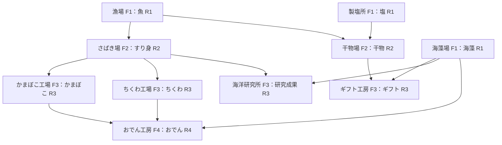

# 施設の次数・桁が増えるレシピ・成長案

更新日: 2026-10-24。必要量を桁で増やし、施設の成長とペンギンの所持効果を同時に扱う改訂案。今回の数値は仮。旧少量モデルを置き換える現行の検討案であり、実装済みではない。[計算の前提と結果](../domain/factory-economy/progression-review.md)を参照する。

## 次数と要求量

R0は現実由来のガス・電気・水。R1は魚・海藻・塩、R2はすり身・干物、R3はかまぼこ・ちくわ・ギフト・研究成果、R4はおでん。生産施設FnはRnを作り、最も高い材料次数はn−1。ズームの階層Zと、施設の生産レベルLvは別に扱う。

| 生産の段階 | 主材料の必要量/バッチ | Lv1の出力 | 開放時の基礎Lv案 | 開放時の出力/バッチ |
|---|---:|---:|---:|---:|
| F1：素材を作る | 材料なし。R0を消費 | 100 | Lv1 | 100 |
| F2：素材を加工 | R1を各100 | 100 | Lv2 | 300 |
| F3：加工品を合流 | R2を1,000、必要ならR1も1,000 | 100 | Lv3 | 1,000 |
| F4：上位品を合流 | R3を各10,000、海藻も10,000 | 100 | Lv4 | 3,000 |

必要な材料の桁は100→1,000→10,000と増やす。同時に古い工場の生産力も上げ、原料を少量ずつ待つ状態から大量生産へ移る。同じLvでは上位ほど多くの前工程が必要になる。

## 施設の成長

| 生産レベル | 出力量の倍率 | 通常施設の中継上限/秒 | 倉庫の中継上限/秒 | 倉庫の基礎保管量/品目 |
|---|---:|---:|---:|---:|
| Lv1 | ×1 | 30 | 300 | 3,000 |
| Lv2 | ×3 | 90 | 900 | 9,000 |
| Lv3 | ×10 | 300 | 3,000 | 30,000 |
| Lv4 | ×30 | 900 | 9,000 | 90,000 |
| Lv5 | ×100 | 3,000 | 30,000 | 300,000 |

F2・F3・F4の開放時に、利用可能な既存施設の基礎Lvも2・3・4へ一括で底上げする案とする。解放直後に旧施設の強化費を払えず詰まることを避けるため、この底上げに追加の費用を付けない。個別施設の強化費と、城の成長に必要な納品点の閾値は別途設計する。Lv5は長期の成長候補であり、今回の初回生産比較に含めない。

同じレシピ・同じ加工時間・同じ材料とR0消費で、出力量にLv倍率を掛ける。さらに所持しているペンギンの補正を掛ける。F4解放後にF1を置き直しても、基礎LvはLv4を使う案。倉庫はF0の補助施設で、品物を増やさない。

保管量は基礎値だけでなく、最大の増量後1バッチと最大入力の2回分を受け止められる値を最低限確保する。大量のペンギンによって1バッチが大きくなっても、出力が保管上限を超えて永久停止しないようにする。中継上限は施設全体で共有する仮値。経路と区画、実際の配送は今回の生産計算では未検証。

## レシピ

表の出力100はLv1・ペンギンなし。各レベルでは出力だけに倍率を掛ける。Gはガス、Eは電気、Wは水で、記載した工程の追加消費。前工程の消費は別に必要。

| 次数 | 施設 | 材料 → Lv1出力 | 加工時間 | 追加R0 |
|---|---|---|---:|---|
| F1 | 漁場 | 材料なし → 魚100 | 10秒 | G1 |
| F1 | 海藻場 | 材料なし → 海藻100 | 10秒 | W1 |
| F1 | 製塩所 | 材料なし → 塩100 | 10秒 | G1・W1 |
| F2 | さばき場 | 魚100 → すり身100 | 20秒 | E1 |
| F2 | 干物場 | 魚100＋塩100 → 干物100 | 20秒 | G1 |
| F3 | かまぼこ工場 | すり身1,000 → かまぼこ100 | 30秒 | E2・W1 |
| F3 | ちくわ工場 | すり身1,000 → ちくわ100 | 30秒 | G2 |
| F3 | 海鮮ギフト工房 | 干物1,000＋海藻1,000 → 海鮮ギフト100 | 30秒 | E2 |
| F3 | 海洋研究所 | すり身1,000＋海藻1,000 → 研究成果100 | 30秒 | E3 |
| F4 | おでん工房 | かまぼこ10,000＋ちくわ10,000＋海藻10,000 → おでん100 | 60秒 | G5・W5 |

例えばLv4のおでん工房は、かまぼこ10,000＋ちくわ10,000＋海藻10,000を使い、60秒でおでん3,000を作る。内部4棟の生産も続き、上位で使った材料だけを在庫から減らす。使わない余剰分の加工も続ける場合は、その分の材料・R0を実際に消費する。

## 資源の流れ

## 納品評価

生産品は全次数で直接納品できる案。納品した個数だけ在庫から減らす。加工で消費した品物を納品点へ重複計上しない。おでんは要求量が大きく変わったので1個300点へ変更し、ほかはまず前案の評価を維持した。

| 次数 | 資源 | 納品点/個 |
|---|---|---:|
| R1 | 魚 | 1 |
| R1 | 海藻 | 2 |
| R1 | 塩 | 2 |
| R2 | すり身 | 4 |
| R2 | 干物 | 6 |
| R3 | かまぼこ | 12 |
| R3 | ちくわ | 8 |
| R3 | 海鮮ギフト | 28 |
| R3 | 研究成果 | 32 |
| R4 | おでん | 300 |

Lv4・ペンギンなしの長期平均では、前工程を含むR0合計1あたりの納品点は、ギフト約31,111、研究約26,103、おでん約27,867。G・E・Wを同価値として比較した目安であり、補給の偏りと加工時間で有利な経路は変わる。旧案の8点/エネルギーという基準は使わない。

## 初回生産の確認

対象施設を各1棟、空在庫から開始し、必要なバッチだけ動かす計算を行った。材料の到着・加工の開始と終了は時系列で扱う。配置・配送待ち・建築と解放の過程・保管上限・アプリ終了は含めない。

| 比較 | 初回のおでんが完成 | 完成量 | 累積G/E/W |
|---|---:|---:|---|
| 全施設Lv1、ペンギンなし、R0無制限 | 11時間8分20秒 | 100 | 2,205 / 2,200 / 205 |
| 全施設Lv4、ペンギンなし | 3分30秒 | 3,000 | 14 / 11 / 13 |
| 全施設Lv4、19種を各1羽 | 3分 | 7,200 | 12 / 8 / 11 |

最後の行は所持効果を見る比較条件であり、普通の遭遇数で19種を各1羽入手できるという予測ではない。G/E/W各100の仮補給ではLv1のケースは途中停止し、Lv4のケースは完了した。補給100を現実の歩数・時間・水の量へ換算する値は未設定。

## 組み合わせと既存アセット

Z1のおでん工房は、かまぼこ・ちくわ・海藻場・倉庫の4棟。ギフト工房は漁場・製塩所・干物場・倉庫、海洋研究所は漁場・さばき場・海藻場・倉庫を候補にする。外部供給と内部在庫を扱う接続の詳細は引き続き未決。

漁場・海藻・製塩・さばき・かまぼこ・ちくわ・干物・倉庫・おでん・研究所は、既存v002モデルを使う候補。ギフトの包装設備と品物表示は追加候補。次数・Lv倍率はデータで扱い、モデルを次数や出力の数字ごとに新作する必要はない。

ゲームコード・API・セーブは変更していない。今回の数値、基礎Lvの底上げ、物流上限、納品評価は検討案であり、採用と実機での面白さは未確認。[ペンギン効果と遭遇確率](penguin-effects-proposal.md)を合わせて確認する。
