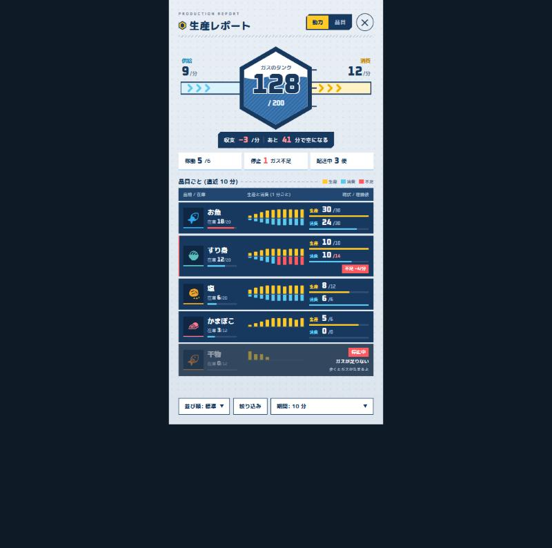

# 生産レポート (全画面) 設計仕様

実装方針と実装上の注意: [`implementation-plan.md`](implementation-plan.md)

## 1. 概要
- ホームはポケモンスリープ寄りの柔らかいトーン。
- 工業モードの「生産レポート」はエンドフィールド寄りのタクティカル・データ中心UI (角張った形・高密度・数字主役)。
- 固有の他作用語は使わず、「生産レポート」「動力」「品目」「ガスのタンク」で統一。
- 数字フォントは Oxanium (OFL)、本文フォントは M PLUS Rounded 1c。

## 2. 決定事項
| 項目 | 決定内容 |
|---|---|
| タンク満タン | 「今の消費 1 時間ぶん」。分母 = `消費/分 × 60`。表示は `現在量 / 分母` |
| 消費が 0 のとき | 分母と「/ N」を非表示、水位は満タン表示。収支札は「いまは減っていない」 |
| 供給/分 | `今日受け取ったガス ÷ 今日 0 時からの経過分` (日平均ペース)。経過分は最低 60 分 |
| 収支 | `供給/分 − 消費/分` |
| あと何分で空 | 収支 < 0 のときだけ `現在量 ÷ \|収支\|` (切り捨て)。収支 ≥ 0 なら「減っていない」 |
| 無制限モード | タンク満タン固定・「∞」表示。収支札は「開発用: 無制限」 |
| 見出し印 | 六角形 (黄塗り・紺縁・紺芯) |

## 3. UI 構成
| 部分 | 仕様 |
|---|---|
| 見出し | 小さな英字 `PRODUCTION REPORT` + 六角形印 + 「生産レポート」。下に斜線ハッチ帯 |
| タブ | 角欠け紺札「動力 / 品目」(選択側は黄)。閉じるは丸枠 ✕ |
| タンク | 紺縁六角形 + 水位 (波・斜線) + 目盛り3本。左に供給パイプ (水色 ›››)、右に消費パイプ (黄 ›››)、中央にガス量 |
| 収支札 | 角欠け紺札「収支 −3/分 ｜ あと 41 分で空になる」 |
| 状態札 | 稼働 X/Y ・停止 Z (赤) ・配送中 W 便 |
| 品目表 | 列見出し帯 + 角立ち紺行 (品物/在庫・1分ごと生産消費上下バー・現状/理論値) |
| 停止行 | 暗転 +「停止中」札 + 理由・次の一手 (「歩くとガスがたまるよ」) |
| 下部帯 | 四角枠 (並び順・絞り込み・期間) |

## 4. 見本
- 全体の見本: `mockup.jpg` (上に貼ったもの。数字は架空の値)
- 見本を作った HTML と、参考にした他作品の画面は共有しない。見た目の正本は、この文書と `mockup.jpg`。
